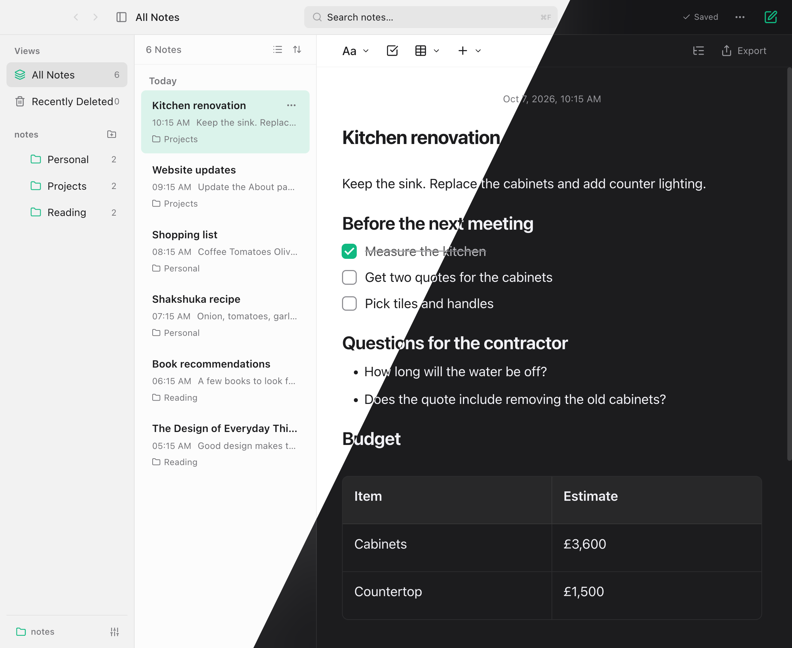

# Scribe

A visual Markdown editor for macOS, with support for Hebrew and English. Notes are saved as `.md` files in a folder you choose.

[Download for macOS](https://github.com/matanby/scribe/releases/latest)



Full screenshots: [Light](docs/images/scribe-main.png) · [Dark](docs/images/scribe-dark.png)

- Format text, checklists, tables, code, and images in the editor.
- Write in Hebrew and English in the same note. Paragraphs, lists, and checkboxes follow each block’s writing direction.
- Open existing Markdown files, search your notes, and capture a note from another app with Quick Capture.
- Save automatically and restore earlier versions from local history.

## Installation

Scribe runs on macOS Big Sur (11) or later.

### Homebrew

With [Homebrew](https://brew.sh) installed, run:

```sh
brew tap matanby/scribe https://github.com/matanby/scribe.git
brew install --cask --no-quarantine matanby/scribe/scribe
```

The cask selects the correct download for your Mac. Scribe is not notarized by Apple; `--no-quarantine` avoids Gatekeeper blocking the first launch. Open Scribe from Applications after installation.

To update an existing Homebrew installation:

```sh
brew update
brew upgrade --cask --no-quarantine matanby/scribe/scribe
```

### Manual download

Get the DMG for your Mac from the [latest release](https://github.com/matanby/scribe/releases/latest). The current version is **1.0.1**:

- [Apple silicon (arm64)](https://github.com/matanby/scribe/releases/download/v1.0.1/Scribe-1.0.1-arm64.dmg)
- [Intel (x64)](https://github.com/matanby/scribe/releases/download/v1.0.1/Scribe-1.0.1-x64.dmg)
- [Browse all releases](https://github.com/matanby/scribe/releases)

Open the DMG, drag Scribe to Applications, then eject the DMG. The current release is not notarized by Apple, so macOS may ask you to confirm the first launch. Control-click Scribe, choose **Open**, then confirm. If needed, use **System Settings → Privacy & Security → Open Anyway**.

## Your notes, your folder

Choose **Open Notes Folder…** to pick where your notes live. A folder managed by Google Drive or another sync service works too; that service handles syncing. Attachments sit in an assets folder beside your notes. Version History is stored locally on this Mac.

## Finder previews

Packaged builds include a Quick Look extension for macOS Monterey (12) or later. Install Scribe in Applications and open it once, then select a `.md` or `.markdown` file in Finder and press **Space** to preview it. Scribe does not need to be running.

If macOS does not show the preview, enable **Scribe** under **System Settings → General → Login Items & Extensions → Quick Look**. Other Markdown preview extensions may need to be disabled. On older macOS versions, look under **Extensions → Quick Look**.

Previews support headings, lists, checklists, tables, code, highlights, and mixed Hebrew/English text. They are read-only. External images and sibling attachments are represented by their labels; Quick Look only grants the extension access to the selected document. Files larger than 2 MB cannot be previewed.

## A few shortcuts

- **⌘N** — New note
- **⌘F** — Find in the current note
- **⌘⇧F** — Find and replace
- **⌃⌥⌘N** — Quick Capture (default; change it in Settings)

See **Help → Keyboard Shortcuts** in the app for the full list. For details on editing, attachments, tables, and version history, see the [feature reference](docs/reference.md).

## Build from source

On a Mac with Node.js 22 or later and Xcode Command Line Tools (needed to compile the native Quick Look extension):

    npm ci
    npm run dist

The DMGs are written to release/. GitHub Actions builds Apple silicon and Intel versions when a version tag is pushed.

Run `npm test` for the app checks and `npm run test:quicklook` for the native WebKit preview checks. Quick Look is bundled by `npm run dist`; the Electron development server does not install it.

Use `npm run test:quicklook -- --benchmark` to measure first-request and subsequent Markdown generation times. These timings exclude Finder's extension launch and display time.

## License

Scribe is available under the [MIT License](https://github.com/matanby/scribe/blob/main/LICENSE).
